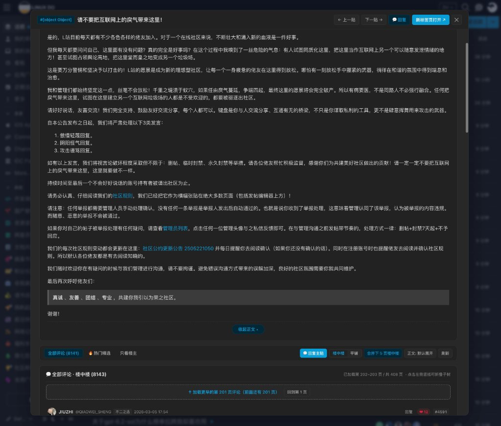
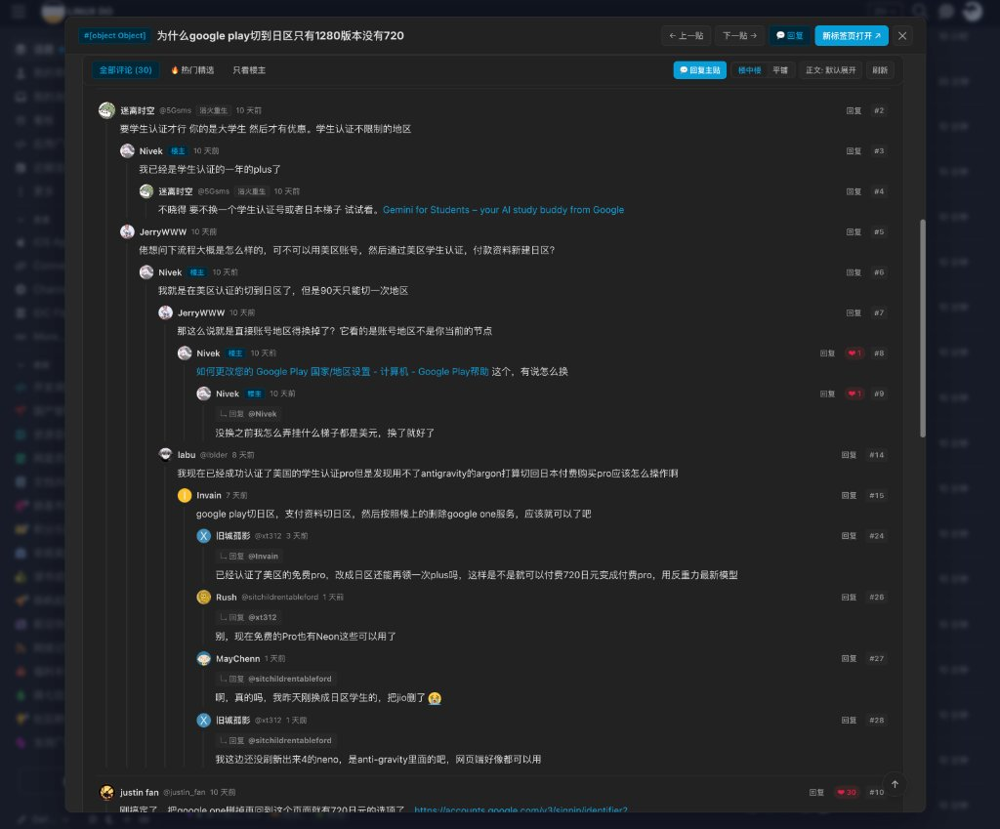

# Linux.do 帖子弹窗阅读器

一款为 [Linux.do](https://linux.do/) 打造的油猴（Userscript）增强脚本。在帖子列表页点击帖子时，无需跳转页面即可在当前页以弹窗形式完整阅读正文与评论，提供 **楼中楼对话树**、**直接回复**、**实时新回复同步**、**阅读位置记忆** 与 **原生已读进度上报**，大幅提升日常刷帖效率。

## 效果预览

### 弹窗正文与工具栏

### 楼中楼对话树与多级嵌套回复

---

## 核心特性

### 1. 列表页无跳转弹窗阅读
- **即点即看**：在帖子列表页左键点击帖子标题或直达楼层链接，直接弹窗打开完整正文与评论，关闭后列表滚动位置丝毫不乱。
- **不干扰原生操作**：`Ctrl / Cmd / Shift / Alt + 点击` 或鼠标中键仍保留浏览器原生打开行为；已处于独立帖子详情页、或点击顶部导航栏 / 搜索框 / 通知面板链接时不拦截。
- **连续刷帖**：支持在弹窗内直接切换当前列表的「上一贴 / 下一贴」，无需反复开关弹窗。

### 2. 原生 Discourse 排版 & 自适应主题
- **无缝跟随深浅色模式**：直接复用 Linux.do 站点的 CSS 主题变量（`--primary`、`--secondary`、`--tertiary` 等）与原生 `.cooked` 样式，自动适配站点的浅色 / 深色及自定义配色方案。
- **完整富文本支持**：保留引用块、代码高亮、Onebox 卡片、Emoji、`
` 折叠块、安全白名单 HTTPS 嵌入卡片等原生元素，同时对 HTML 进行严格 XSS 清洗。
- **内置图片灯箱**：点击正文或评论中的图片即可放大预览，并支持一键在新标签页查看原图。
- **长主贴智能折叠**：当主贴高度超过阈值（默认 `420px`）时自动提供展开/收起按钮，支持在工具栏一键设置并持久化「打开帖子默认展开 / 默认收缩长正文」。

### 3. 楼中楼对话树 & 多视角筛选
- **楼中楼 / 平铺双视图**：自动根据回复关系构建嵌套评论树（最大缩进 5 层，更深层自动扁平化并显示 `↳ 回复 @用户名` 提示），也可随时切换为传统平铺视图。
- **子树折叠**：点击任意楼层左侧的竖线即可折叠/展开该楼层及其全部子回复，支持一键「全部展开」。
- **多维度筛选**：支持切换 **全部评论**、**🔥 热门精选**（调用 Discourse `filter=summary`，回复数 ≥ 5 时显示）以及 **只看楼主**。
- **跨页上下文与无限滚动**：
  - 打开帖子后后台节流自动预加载前 3 页，保证常见讨论的楼中楼上下文完整。
  - 下滑至底部自动续载下一页；从中间楼层打开时支持在评论区顶部向上加载更早页。
  - 支持一键「合并多页楼中楼」将多页评论融合进同一棵树；遇到跨页引用的原楼或未展开子回复时，可按需单条拉取。

### 4. 弹窗内直接回复
- 支持直接回复主贴或任意评论楼层，内置 Markdown 输入框与 `Ctrl / Cmd + Enter` 快捷发送。
- 自动获取站点 CSRF Token 并复用当前登录态；回复成功后无缝插入当前评论流，后台预加载重绘时也不会打断正在输入的光标位置。

### 5. 实时自动刷新（新回复 & 内容修订）
- 优先复用 Linux.do 页面原生的 Discourse `MessageBus` 订阅 `/topic/{tid}` 通道，实时接收新回复与楼层编辑更新。
- 若运行环境无法访问 `MessageBus`，自动降级为仅在前台标签页激活时执行的礼貌低频轮询（30s → 60s 逐步退避）。
- 正在查看最新页或当前可见楼层收到子回复时无缝插入；查看较早页时则在顶部弹出新回复提示条，点击直达最新页。

### 6. 阅读位置记忆 & 原生已读同步
- **精准断点续读**：自动记录最近 300 个帖子的精确阅读楼层与视口偏移量，并与 Discourse 服务端 `last_read_post_number` 智能合并；跨设备/多标签读得更远时自动同步到最新进度。
- **直达楼层支持**：点击列表中的未读回复角标或最新回复时间列时，自动计算并定位到对应楼层。
- **消除未读小蓝点**：内置阅读计时器，按 Discourse 原生机制定期通过 `POST /topics/timings` 上报可视楼层阅读时长，同步服务端已读状态，并以纯 CSS 方式安全更新列表页已读状态与未读角标（不破坏 Ember/Glimmer DOM 树）。
- **已读标记**：本地记录最近 500 个已读帖子并淡化列表标题，方便快速分辨浏览过的帖子。

### 7. 站方友好的防限频（429）机制
- **Stale-While-Revalidate 缓存**：会话内重复打开帖子直接秒开缓存，15 秒内再次打开免重复请求元数据。
- **节流与退避**：后台预加载与批量合并均采用串行 + 逐页递增退避策略，无限滚动自带请求冷却。
- **自动响应 429**：若触发站点频控（HTTP `429`），自动解析 `Retry-After` 响应头进入冷却并暂停自动加载，避免持续请求。

---

## 安装方式

首先需要安装任意一款浏览器用户脚本管理器扩展：
- [Tampermonkey（篡改猴）](https://www.tampermonkey.net/)（Chrome / Edge / Firefox / Safari）
- [Violentmonkey（暴力猴）](https://violentmonkey.github.io/)
- [ScriptCat（脚本猫）](https://docs.scriptcat.org/)

### 方式一：通过 GreasyFork 安装（推荐，支持自动更新）
前往 GreasyFork 脚本页或直接点击安装链接：
- 脚本主页：[https://greasyfork.org/scripts/607220](https://greasyfork.org/scripts/607220)
- 直接安装：[Linux.do 帖子弹窗阅读器 (.user.js)](https://update.greasyfork.org/scripts/607220/Linuxdo%20%E5%B8%96%E5%AD%90%E5%BC%B9%E7%AA%97%E9%98%85%E8%AF%BB%E5%99%A8.user.js)

### 方式二：通过 GitHub Raw 安装
点击下方链接由油猴管理器直接拉取安装：
- [从 GitHub Raw 安装 linuxdo-topic-modal.user.js](https://raw.githubusercontent.com/toujourser/linuxdo-topic-modal/main/linuxdo-topic-modal.user.js)

### 方式三：手动安装
1. 打开本仓库中的 [linuxdo-topic-modal.user.js](./linuxdo-topic-modal.user.js) 并复制全部代码。
2. 在油猴管理器中选择「添加新脚本」，粘贴代码并保存。
3. 刷新 [https://linux.do](https://linux.do/) 即可生效。

---

## 快捷键与操作说明

| 场景 | 快捷键 / 操作 | 功能说明 |
| --- | --- | --- |
| 帖子列表页 | `左键点击` 帖子标题 / 楼层链接 | 在当前页弹出阅读器窗口 |
| 帖子列表页 | `Ctrl / Cmd / Shift / Alt + 左键` 或 `中键` | 绕过弹窗，按浏览器默认方式打开原帖 |
| 弹窗内 | `Esc` | 逐层关闭：图片灯箱 → 回复输入框 → 帖子弹窗 |
| 弹窗内 | `←` / `→` | 切换当前列表的上一贴 / 下一贴 |
| 弹窗内 | 点击弹窗外遮罩区域 | 关闭弹窗 |
| 回复输入框内 | `Ctrl / Cmd + Enter` | 快捷发送当前回复 |
| 楼中楼评论区 | 点击楼层左侧竖线 | 折叠 / 展开该楼层及其全部子回复 |

---

## 可调配置项

脚本顶部提供了一组常量，高级用户或二次开发者可按需微调：

| 常量名 | 默认值 | 说明 |
| --- | --- | --- |
| `OP_COLLAPSE_MAX_HEIGHT` | `420` | 主贴正文超过该像素高度时显示折叠/展开按钮 |
| `AUTO_PRELOAD_PAGES` | `3` | 打开帖子后后台自动串行预加载的初始页数 |
| `MAX_INDENT_DEPTH` | `5` | 楼中楼最大嵌套缩进层级 |
| `PAGE_SIZE` | `20` | 每页评论拉取条数 |
| `BATCH_MERGE_SIZE` | `5` | 单次「合并下 N 页楼中楼」的页数 |
| `MAX_VISITED` | `500` | 本地记录已读帖子 ID 上限 |
| `MAX_SAVED_POSITIONS` | `300` | 本地记忆精确阅读位置的帖子上限 |
| `LDM_DIAG_LOG` | `false` | 是否在控制台输出诊断日志（排查问题时可改为 `true`） |

---

## 权限与隐私说明

- **仅作用于 Linux.do**：脚本通过 `@match https://linux.do/*` 严格限制生效范围，不会在其他网站运行。
- **零第三方请求**：所有网络请求均为同源调用 Linux.do 原生 Discourse JSON 接口（如 `/t/{id}.json`、`/t/{id}/posts.json`、`/posts.json`、`/topics/timings` 等），不包含任何统计埋点、广告或第三方服务器通信。
- **脚本权限说明**：
  - `GM_addStyle`：向页面注入弹窗与楼中楼组件样式。
  - `unsafeWindow`：仅用于在可用时访问页面原生的 `MessageBus` 实例以实现新回复实时推送；如不可用则自动降级为常规轮询。
- **本地存储（`localStorage`）**：
  - `ldm_visited_tids_v1`：已读帖子 ID 列表（最多 500 条）。
  - `ldm_read_positions_v1`：各帖子上次阅读位置快照（最多 300 条）。
  - `ldm_default_collapse_op_v1`：长主贴默认展开/收缩偏好。

---

## 常见问题

为什么某些帖子打开提示 401 / 403？

说明该帖子所属分区需要登录或特定信任等级权限，脚本直接复用当前浏览器的 Linux.do 登录状态，请确认已在当前浏览器登录且具备访问权限。

为什么有时会提示 429 或暂停自动加载？

Linux.do 对短时间高频接口请求有速率限制（HTTP `429`）。脚本内置了自动退避和冷却机制，遇到 429 时会暂停自动翻页/预加载并在冷却后恢复，期间仍可手动点击「继续加载」或在新标签页查看原帖。

如何在弹窗阅读的同时用原生页面打开？

在列表页按住 `Ctrl`（macOS 为 `Cmd`）点击帖子标题，或点击弹窗右上角的「新标签页打开 ↗」按钮即可。

---

## 反馈与贡献

欢迎通过 [GitHub Issues](https://github.com/toujourser/linuxdo-topic-modal/issues) 提交 Bug 反馈或功能建议，也欢迎提交 Pull Request 参与改进：

1. Fork 本仓库并创建你的特性分支（`git checkout -b feat/your-feature`）。
2. 修改 `linuxdo-topic-modal.user.js` 并在 Linux.do 实际页面中充分验证（含深浅色主题、长贴、多页楼中楼、SPA 路由切换等场景）。
3. 提交变更并发起 Pull Request。

## 开源协议

本项目基于 [MIT License](./LICENSE) 开源。
